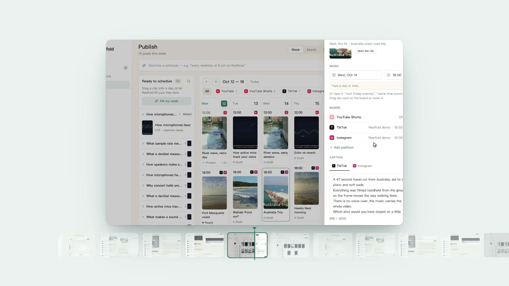

<p align="center">
  <b>English</b> · <a href="README.zh-CN.md">简体中文</a> · <a href="README.fr.md">Français</a> · <a href="README.es.md">Español</a>
</p>

<p align="center">
  <picture>
    <source media="(prefers-color-scheme: dark)" srcset="docs/brand/wordmark-on-dark.svg">
    
  </picture>
</p>

<p align="center"><b>The open-source workbench for creators.</b><br>
One sentence turns your footage into a batch of ready-to-post videos for every platform, in English and Chinese.
Open source, free, and all on your Mac.<br>
千剪：一句话，把你的素材批量剪成多平台、中英双语、可直接发布的成片，开源免费，全在本地。</p>

<p align="center">
  <a href="https://reelfold.com/demo/">Watch the demo</a> ·
  <a href="https://reelfold.com/docs/">Docs</a> ·
  <a href="https://github.com/zyziyun/reelfold/releases/latest">Download for macOS</a> ·
  <a href="https://reelfold.com">reelfold.com</a> ·
  <a href="docs/PRESS_KIT.md">Media kit</a> ·
  <a href="LICENSE">MIT</a>
</p>

<p align="center">
  <a href="https://reelfold.com/demo/?utm_source=github&utm_medium=readme&utm_campaign=organic-discovery">
    
  </a>
</p>

### Try one workflow, then share what happened

[Make several videos from a folder](https://reelfold.com/docs/guides/several-videos/) ·
[Record camera and screen](https://reelfold.com/docs/guides/recording/) ·
[Share a result](https://github.com/zyziyun/reelfold/discussions/new?category=show-and-tell) ·
[Ask a question](https://github.com/zyziyun/reelfold/discussions/new?category=q-a)

Footage in, edit, covers, a version per platform and language, publish: one workbench for self-media and course
creators, at batch scale.

- **A whole set from one sentence.** Point it at a folder or an SD card and ask for "12 or so videos, each with its
  own theme". It groups the footage into stories, plans the set you asked for (say 10 to 20 videos) and makes them a few at a time on
  autopilot. Hundreds of edits in one run; every decision is logged with its reason and can be changed.
- **Every platform, its own cut and language.** YouTube, TikTok, Instagram, X and LinkedIn first, then Xiaohongshu,
  Douyin, Bilibili and WeChat Channels: 20 platforms, each with its own size, length (a long cut with chapters for
  YouTube, short cuts for Shorts and TikTok), captions, loudness, cover and copy. YouTube and TikTok get English,
  Xiaohongshu and Bilibili get Chinese.
- **Your real footage, edited with craft.** A template per kind of video, cuts on the beat (Beat This!), shot
  detection, colour matched per shot, smooth jump cuts and clean slow motion (RIFE), subject-following vertical crops,
  and a built-in library of 52 CC0 music tracks. AI generation only fills gaps, after you approve the price.
- **Covers and checks.** Covers pick a sharp frame, cut out the subject, upscale it and keep the title clear of faces
  and app buttons, with three YouTube A/B options. Every file is checked for flicker, framing, loudness, caption
  language and on-screen text; explainer narration is fact-checked. You look only at what was flagged.
- **Keep editing, anywhere.** Import a finished video to edit it again, keep your hand edits when the AI re-renders,
  record yourself with the teleprompter, add your watermark, and send any clip to Premiere Pro, DaVinci Resolve,
  CapCut / 剪映 or OpenTimelineIO.
- **Publish from a calendar.** YouTube uploads and schedules through its official Data API; for the other platforms
  Reelfold fills in the upload page and you press publish. Nothing posts until you say so.
- **Local, private, free, your AI.** Rendering, transcription and the free voices (Kokoro for English, Qwen3-TTS for
  Chinese) run on your Mac. Bring your own AI: Claude Code, Codex, ACP coding agents (Gemini CLI, Qwen Code, Kimi
  CLI ...), API keys including providers that work in mainland China, or a local model; pick the AI and model per
  request, or `/model` in the chat. MIT licensed.


## Get it

**Mac app** (Apple Silicon, free): signed and notarized, from
[Releases](https://github.com/zyziyun/reelfold/releases/latest), or
[build from source](https://reelfold.com/docs/start/install-mac/). On Autopilot it takes one sentence to finished
clips and logs every choice it made; Windows is in preview.

**Claude Code skill** (same engine, still named `video-studio`):

```bash
git clone https://github.com/zyziyun/reelfold ~/.claude/skills/video-studio
~/.claude/skills/video-studio/install.sh
cp ~/.claude/skills/video-studio/persona.example.yaml ~/.claude/skills/video-studio/persona.local.yaml
```

AI runs on what you already have: your Claude Code or Codex login, another ACP coding agent, your own API key, or a
local model.

**Docs → [reelfold.com/docs](https://reelfold.com/docs/)**

## Say it like this

| You want | Say something like |
|---|---|
| Several videos from one card | "Make about 12 videos from my DJI card, each with its own theme, for YouTube and Xiaohongshu" |
| Keep editing a finished video | "Here is last week's video: tighten the opening, new cover, and make a vertical version for TikTok" |
| A tight talking-head short | "Cut the pauses, filler words and repeats, speed it up 1.1×, add captions and a progress bar, export for TikTok and Shorts" |
| A lecture as vertical clips | "Slice this 70-minute lecture into 3 vertical episodes, one idea each, zoom into the code, with covers and post copy" |
| A podcast clip | "Find the best minute of this Zoom podcast, hide the guest's face and name label, vertical" |
| A fast travel vlog | "Make a fast beat-cut vlog from these Disneyland photos and clips, with day stamps, places, sound effects, 9:16" |
| One video, many platforms | "Export this for Xiaohongshu 3:4, TikTok and YouTube Shorts, each with its own safe zones and loudness" |

More: [example prompts](https://reelfold.com/docs/examples/).

## Learn more

[Getting started](https://reelfold.com/docs/start/what-is-reelfold/) ·
[Guides](https://reelfold.com/docs/guides/talking-head/) ·
[Concepts](https://reelfold.com/docs/concepts/projects/) ·
[Reference](https://reelfold.com/docs/reference/) ·
[Troubleshooting](https://reelfold.com/docs/help/troubleshooting/) ·
[Contributing](https://reelfold.com/docs/contributing/)

## License

MIT, including the desktop app (`apps/desk`), the website (`apps/site`) and the docs (`apps/docs`). Fonts and models
are downloaded at install time under their own licences (SIL OFL 1.1, Apache-2.0); the website and the docs ship
their own OFL web fonts. Built with
[HyperFrames](https://hyperframes.heygen.com) for the HTML-to-video workflows.

Formerly **video-studio** (the skill and engine) and **Daycut** (the desktop app). Existing installs in
`~/.claude/skills/video-studio` keep working; point them at the new URL with
`git -C ~/.claude/skills/video-studio remote set-url origin https://github.com/zyziyun/reelfold`.
